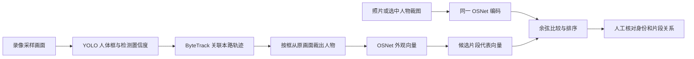

# YOLO、ByteTrack 与 ReID 如何连接

更新：2026-10-26。本文依据当前项目源码及本机安装的 Ultralytics ByteTrack 实现，描述已实现的数据流，不代表新增算法或效果提升。

三个环节传递的数据分别是：检测框 → 带本路编号的轨迹及人物裁图 → 可比较的外观向量。当前 OSNet 不参与 ByteTrack 的本路关联代价。



未被跟踪器纳入轨迹、但符合项目保留条件的检测，会作为单帧候选继续编码与检索。参考图也可以直接由 OSNet 编码，因此 ReID 并不要求先取得一个跟踪 ID。

## 1. YOLO 把什么交给 ByteTrack

YOLO 对每个输入画面产生一组检测结果，可理解为：

```text
检测结果 = 人体框 [x1, y1, x2, y2] + person 类别 + 检测置信度
```

检测阶段只判断当前画面哪里有人，不给出跨画面的同一人身份。当前项目调用：

```python
model.track(frame, persist=True, classes=[0], tracker='bytetrack.yaml', ...)
```

这是 Ultralytics 将检测与跟踪封装在一次调用中的接口：先运行 YOLO，再由已注册的跟踪器处理检测框。`persist=True` 让同一次录像处理中的跟踪状态延续到后续输入画面；`classes=[0]` 保留 person 类别；项目显式选择 ByteTrack，不依赖 SDK 最新版的默认跟踪器。

具体调用与保留原始检测的逻辑见 [`detection.py`](../../app/tracking3/detection.py)。上游接口说明见 [Ultralytics Track 文档](https://docs.ultralytics.com/modes/track/)。

## 2. ByteTrack 怎样把框连成轨迹

ByteTrack 维护之前的轨迹状态，用 Kalman 滤波预测下一次输入时可能出现的位置，再与新检测框做关联。当前安装实现先关联高置信检测，接着尝试用较低置信检测延续尚未匹配的轨迹；主关联使用框的 IoU 距离并融合检测分数，第二阶段使用 IoU。多个人同时出现时，关联算法共同处理匹配关系。

其中 IoU 表示两个框交集面积与并集面积之比，帮助衡量预测位置与新检测的位置重合程度。匹配成功则更新原轨迹、沿用 ID；合适的新检测可以建立新轨迹；短时未匹配会进入丢失状态，过期后被移除。参见 [ByteTrack 作者仓库](https://github.com/FoundationVision/ByteTrack)。

下面只是机制示意，并非真实实验结果：

```text
采样点1：YOLO检测到一人，建立轨迹 A:T17
采样点2：预测T17稍向右移动，新检测框接近预测位置，沿用 A:T17
采样点3：再次匹配并更新，继续沿用 A:T17
```

ID 表示这次跟踪过程中的一条轨迹，不是人员姓名或跨摄像头的统一身份。遮挡、交叉或较大的采样间隔可能导致断轨和 ID 切换。不同镜头 ID 相同没有身份含义，ID 不同也可能对应同一个人。

## 3. 轨迹怎样连接到 OSNet

当前 [`engine.py`](../../app/tracking3/engine.py) 在拿到 `box, confidence, local_id` 后执行：

```text
按人体框从当前原图裁出人物 → encoder.extract(人物裁图)
```

OSNet 接收图像而不是轨迹编号；本项目的 [`reid.py`](../../app/tracking3/reid.py) 将 RGB 裁图缩放到高256×宽128，归一化后输入网络，得到512维外观向量并做 L2 归一化。每个向量同时通过项目记录关联到素材、机位、媒体时间、轨迹片段及裁图。模型上游见 [OSNet / Torchreid](https://github.com/KaiyangZhou/deep-person-reid)。

因此两种关联有所区别：

| 关联 | 当前依据 | 输出 |
|---|---|---|
| 相邻已处理画面之间 | ByteTrack 的运动预测、框重合度及检测分数 | 本路轨迹 ID |
| 查询图与候选片段之间 | OSNet 外观向量的余弦相似度 | 候选排序，身份需核对 |

当前并没有把 OSNet 向量送回 ByteTrack，借此决定下一帧沿用哪个 ID。每个采样检测都会调用外观编码；默认候选记录最终保留片段中检测置信度最高的一张代表图及其向量，检索时使用这一代表向量，没有进行整段多帧特征融合。检测置信度高不一定意味着全身完整或最适合 ReID。

## 4. 两个非重叠镜头怎样寻找同一个人

假设目标在镜头 A 的本路编号为 T17，之后在镜头 B 被编号为 T8。两个镜头先各自完成检测与本路跟踪，再把所选目标裁图编码，与 B 路各候选片段的代表向量比较：

```text
归一化查询向量 · 归一化候选向量 = 余弦相似度
```

示意排序若是 B:T8 高、B:T12 低，说明模型认为前者外观更接近，人工仍需核对是否同一人。ReID 不是把 A:T17 这个编号传给镜头 B。当前系统也不会仅凭最高分自动认定跨镜头身份；来源、裁图质量和时间关系仍要检查。

两个视野之间没有覆盖的区域无法通过视频直接观测到行走路径；共同时间未经确认时也不能推断准确先后或转移用时。

## 5. 与当前回放页的关系

默认索引约3fps，仅实际输入的采样画面经过检测与关联，未对原录像每一帧都计算。跟踪器的预测用于关联；网页没有把预测框当成未检出时刻的真实观测。

目标回放读取已保存的采样画面、框和片段 ID，播放时不重新运行三种模型。点选人物会切换当前查看的片段，不会启动新的在线单目标跟踪器。视觉上框连续跟随，仍需核对框中的人物是否一直正确，不能单靠 ID 不变证明身份正确。
